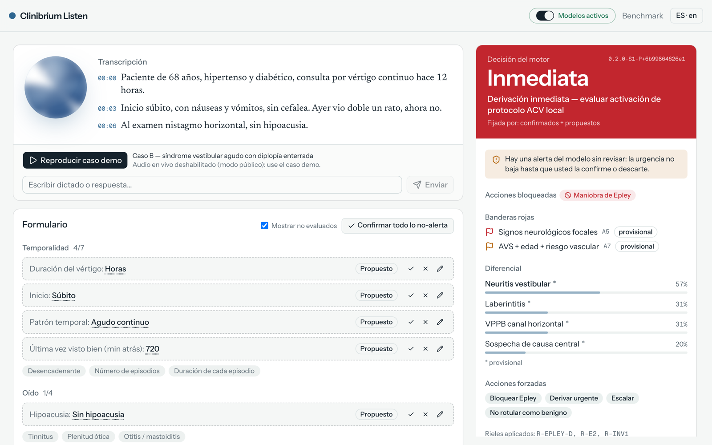
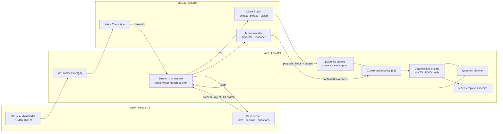
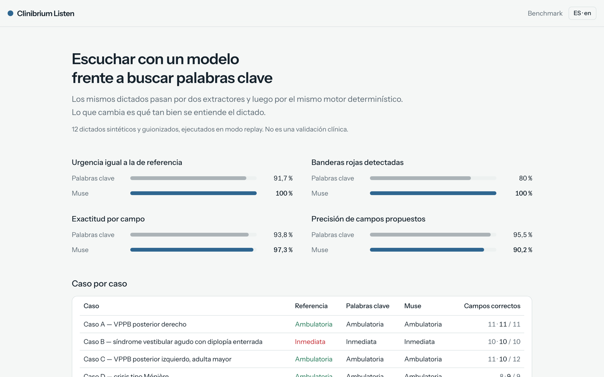

# Clinibrium Listen

**A second pair of ears for vertigo in the emergency room.**
The physician dictates. Meta's models listen, structure and ask. A deterministic
clinical rules engine makes the safety call. The physician decides.

> **Research prototype · Not for clinical use · The physician decides.**
> Not an AI diagnosis tool. Scripted dictations only — no real patient data.

**Try it:** [clinibrium-listen.vercel.app](https://clinibrium-listen.vercel.app) — public replay mode, two scripted cases, no sign-up.
Built for the Meta Global AI Developer Hackathon (Indie track, *Build for Your World*).



---

## Why

Dizziness is one of the most common reasons to visit an emergency room, and most
cases are benign. A small share are posterior-circulation strokes that look the
same at first glance. Emergency physicians' time is the scarcest resource in the
room. Clinibrium Listen gives that time back:

- the physician **dictates as usual** instead of filling a form;
- the system **asks for the one missing item** that would change the decision (a
  Dix-Hallpike, a HINTS exam, the time of onset);
- it ends with a **referral decision, a referral letter and a verifiable receipt**,
  so the patient is discharged, referred or escalated quickly.

It does **not** diagnose. It structures what the physician said, applies fixed
rules, and leaves every decision to the physician.

## How it decides: deterministic + ML + LLM, each in its lane

| Layer | What it does | What it can **never** do |
|---|---|---|
| **Speech model (ML)** — `muse-voice-transcribe-1.0` | Live transcription of the Spanish dictation, streamed over a WebSocket | — |
| **LLMs** — `muse-spark-1.3`, `muse-wonder-1.0` | Propose field values *with the exact quote* they came from; phrase the next question; read a medication photo; a second-look "stroke advocate"; explain the final decision with cited sources | Set urgency, block or force an action, write the letter |
| **Deterministic engine** — `engine/clinibrium` | Red flags (including **HINTS**: head impulse, nystagmus, test of skew), a differential built on the team's paraphrase of the **Bárány Society ICVD criteria**, safety rails, urgency and referral | Change without a signed clinical review — the logic is frozen and fingerprinted |
| **Physician** | Confirms, rejects or edits each finding; resolves conflicts; finalizes | — |

The engine was built before the hackathon and ported unchanged
(`engine/tests/test_versions.py` proves the ruleset fingerprints match). See
[PROVENANCE.md](PROVENANCE.md).

## Safety invariants

Every rule below has a test that tries to break it (`api/tests/test_invariants_listen.py`).

| | Rule |
|---|---|
| **L1** | Unconfirmed values can **raise** urgency or block actions, never lower them. The engine runs twice — confirmed only, and confirmed + proposed — and the stricter result wins. |
| **L2** | A proposed value must quote the dictation, and the quote must support the value. "sin diplopía" can never become `diplopia = true`. |
| **L3** | Models never set urgency or actions; they only propose fields or ask for a confirmation. |
| **L4** | **Kill switch:** with every model off, the same state gives the identical decision. |
| L5 | Rejected values never count. Sticky alerts are cleared only by the physician. |
| L6 | The question planner is deterministic. |
| L7 | The referral letter is a template bound to confirmed fields — no model prose. |
| L8 | The receipt is `sha256(canonical_json)`, and the browser re-verifies it with WebCrypto. |
| L9 | Model payloads contain only redacted turns and catalog keys; the builder fails closed. |
| L10 | Stale model results (after the kill switch, after finalize, or superseded) are discarded. |
| L11 | Urgency ordering always uses the rank table, never string comparison. |

Full policy: [SPECS.md §6](SPECS.md#6-safety-policy--apilistenpolicypy--evidencepy).

## Architecture



Every model sits behind an interface (`api/muse/interfaces.py`) with three
implementations, chosen by `MUSE_MODE`:

- `mock` — deterministic fakes, used by the tests;
- `replay` — recorded Meta responses (`fixtures/replays/`), fully offline; this is what the public site runs;
- `live` — the Meta Model API, behind an access code, daily caps and fail-closed budgets ([DEPLOY.md](DEPLOY.md)).

## The two demo cases

| Case | What it shows | Ends at |
|---|---|---|
| **A — right posterior BPPV** | The dictated Dix-Hallpike keeps urgency at *Prioritaria* and Epley blocked **until the physician confirms it** (L1). After confirmation: *Ambulatoria*, Epley allowed. | Ambulatoria |
| **B — acute vestibular syndrome with buried diplopia** | "Ayer vio doble un rato" is caught as a sticky alert, the engine sets *Inmediata* and blocks Epley, the stroke-window clock starts, and a medication photo adds anticoagulation. The kill switch leaves the decision unchanged (L4). | Inmediata |

The full shot list is in [docs/DEMO_SCRIPT.md](docs/DEMO_SCRIPT.md). The browser
end-to-end run of both cases passes 26/26 checks against the deployed site
([docs/DEMO_CHECKLIST.md](docs/DEMO_CHECKLIST.md)).

## Bench: listening with a model vs keyword matching

Twelve scripted Chilean-Spanish dictations go through two extractors, then
through the **same** deterministic engine. Replay mode, recorded from live runs:

| Metric | Keyword baseline | Muse |
|---|---|---|
| Urgency matches reference | 91.7 % | **100 %** |
| Under-triaged cases | 1 | **0** |
| Red flags detected | 80 % | **100 %** |
| Negations read correctly | 97.2 % | **100 %** |
| Per-field accuracy | 93.8 % | **97.3 %** |
| Precision of proposed fields | **95.5 %** | 90.2 % |

The under-triaged case is F: the keyword baseline misses "the family noticed
slurred speech" and sends a stroke home as *Ambulatoria*; with Muse the engine
says *Inmediata*. Muse proposes more fields, so its precision is lower, and
every one of those proposals waits for the physician.

**These are synthetic, scripted cases, not a clinical validation.** Method and
limits: [bench/README.md](bench/README.md). Live view: [/bench](https://clinibrium-listen.vercel.app/bench).



## Run it locally

Requirements: Python 3.12 with [uv](https://docs.astral.sh/uv/), Node 22 with pnpm.

```bash
cp .env.example .env                       # MUSE_MODE=mock by default; no key needed
uv sync
uv run uvicorn api.main:app --reload       # API on :8000
cd web && pnpm install && pnpm dev         # web on :3000
```

- Replay mode (what the public site runs): set `MUSE_MODE=replay`.
- Live mode needs `MODEL_API_KEY`, `LIVE_AUDIO=1`, a `DEMO_ACCESS_CODE` and budget caps. See [DEPLOY.md](DEPLOY.md).
- `./check.sh` is the gate: ruff, mypy, pytest (engine, API, invariants, bench), generated-file freshness, web typecheck, lint and tests.
- `web/e2e/run-replay.sh` runs the browser end-to-end check of both demo cases.
- `uv run python bench/run.py --mode replay` regenerates the bench table.

## Repository map

| Path | What |
|---|---|
| [`engine/`](engine/) | Deterministic engine (`clinibrium`): red flags, differential, rails, counterfactuals. Ported, frozen, fingerprinted. |
| [`api/listen/`](api/listen/) | Session orchestrator, evidence checks, conservative policy, planner, window clock, letter, receipt |
| [`api/muse/`](api/muse/) | Meta Model API clients (ASR relay, extractor, phrasing, advocate, vision, reasoner), replay and budget guards |
| [`web/`](web/) | Next.js 16 + shadcn/ui front end |
| [`bench/`](bench/) | 12 gold-labelled cases, keyword baseline, runner, results |
| [`config/`](config/) | Field catalog (generated), protocol windows, referral labels, ASR keywords |
| [`fixtures/`](fixtures/) | Recorded replays, scripted audio, usage ledgers (counters only) |
| [`docs/`](docs/) | Smoke test, demo checklist, demo script, pitch |

## Data handling and limitations

- **No real patient data.** All dictations, audio and the medication photo are scripted.
- The public deployment runs **replay only** and never calls Meta. Live sessions (used to record the demo) send scripted audio, text and images to the Meta Model API.
- The only secret is `MODEL_API_KEY`, held as a server environment variable.
- The engine covers **adult vertigo and dizziness** only; some criteria carry `TODO(clinical)` notes awaiting specialist review.
- Spanish dictation only; the UI is bilingual (ES/EN).
- Sessions live in memory: no database, no authentication, no EHR integration.
- Not clinically validated and not approved by any regulatory authority. **The physician decides.**

## License

Apache-2.0 — see [LICENSE](LICENSE), [NOTICE](NOTICE) and [PROVENANCE.md](PROVENANCE.md).
The Bárány Society ICVD criteria are used only in the team's own paraphrase; the
ICVD text itself is not distributed here.
